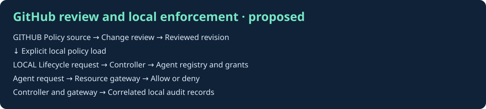

# Architecture

Status: proposed Sprint 1 design.

GitHub holds policy source, change reviews, and sanitized evidence. The local runtime loads an explicitly selected policy revision. A GitHub merge does not itself create runtime access.

The lifecycle controller accepts events with unique IDs, validates approval and current state, and writes changes to the agent registry and grant store. Track each agent's stable ID, owner, role, status, and authorization version. A grant binds an agent to a resource, action, and expiration. Replayed event IDs return their recorded outcome.

The resource gateway checks current identity status, authorization version, expiry, and action scope on each request. Deny on missing state or failed evaluation. On a move, invalidate superseded access before activating replacement grants. On departure, disable the identity and advance its authorization version so older sessions fail checks. Keep state changes consistent and define recovery behavior before adding external systems.

Audit records carry event ID, agent ID, actor, policy revision, decision, reason, and timestamp. Store sanitized records locally. The audit trail is designed for review, with tamper-resistance to be evaluated separately.
