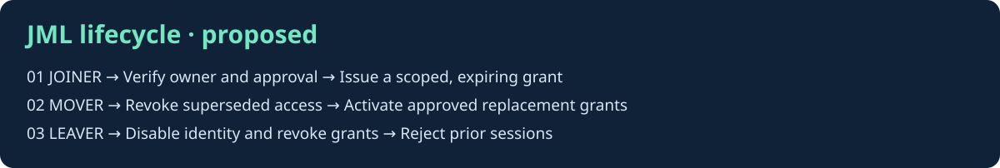
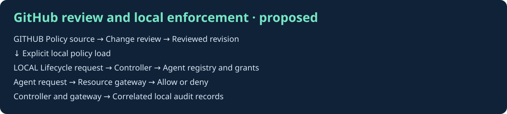
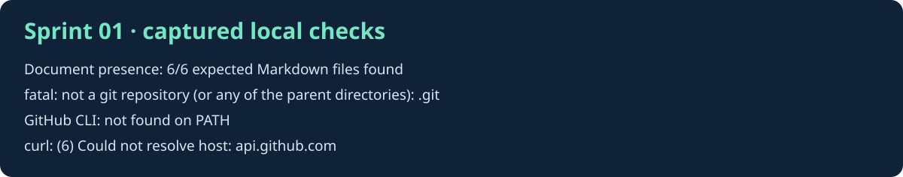

# Sprint 01 · Foundation

Local foundation prepared. Git was initialized on `main`. GitHub publication is pending authenticated access. No JML runtime or billable services were deployed.

## 01. Define the lifecycle scope

The [charter](../docs/project-charter.md) defines the expected access changes and the evidence needed for each lifecycle event.

## 02. Define the trust boundaries

The [architecture](../docs/architecture.md) separates policy review from local enforcement. The [threat model](../docs/threat-model.md) maps planned controls to tests and sprints.

## 03. Verify the local foundation

This visual was generated from actual workspace checks. The initial checks are preserved below. On retry, Git initialization succeeded, the GitHub API returned HTTP 200 for its public endpoint, and the stored credential returned HTTP 401 on the authenticated account endpoint.

## Screenshot index

| Figure | File | Type | Status |
| --- | --- | --- | --- |
| 01 | [01-jml.svg](screenshots/01-jml.svg) | Design diagram | Included |
| 02 | [02-architecture.svg](screenshots/02-architecture.svg) | Design diagram | Included |
| 03 | [03-local-verification.svg](screenshots/03-local-verification.svg) | Rendered command evidence | Captured locally |
| 04 | GitHub repository and initial files | Screenshot | Pending access and publication |

## Acceptance and handoff

- [x] Charter, architecture, threat model, and seven-sprint tracker present.
- [x] Sprint visuals embedded in order and indexed.
- [x] Initialize Git on `main`.
- [ ] Confirm the initial local commit.
- [ ] Verify the authenticated GitHub account, destination owner, repository visibility, and permission to create repositories.
- [ ] Create `identitychain-ai-governance-lab`, push the foundation, and capture the repository page with the initial files visible.
