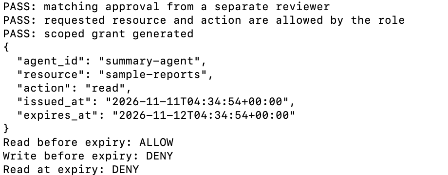

# Sprint 03 · Joiner

A synthetic owner requests a 24-hour grant for `summary-agent` to read `sample-reports`. A separate reviewer records the approved details, and the script checks the Sprint 2 role policy before generating the grant.

Run from the repository folder:

```sh
python3 sprint-03-joiner/joiner.py
```

## 01. Reject an approval for a different request


The approval was for `joiner-002`, so it could not authorize request `joiner-001`.

## 02. Reject an action outside the role policy


During the earlier policy test, approval was matched by ID alone. The reviewer check passed, but the reader policy denied the write. To exercise this policy check with the final script, use a write action in both the request and the approved details.

## 03. Reject a change to approved details


After approval was bound to the request details, increasing the duration from 24 to 48 hours caused a denial even with the same request ID.

## 04. Generate and test a scoped grant



The approved request generated a 24-hour grant. The simulation allowed the matching read before expiry, denied a write, and denied a read at the exact expiry time.

## 05. Reject a request without approval


Temporarily renaming `approval.json` caused the script to deny the request. Restoring it let the approved request run again.

## Screenshot index

| Figure | Evidence |
| --- | --- |
| 01 | [Wrong request ID](screenshots/01-wrong-request.png) |
| 02 | [Policy denial](screenshots/02-policy-denial.png) |
| 03 | [Changed duration](screenshots/03-changed-duration.png) |
| 04 | [Grant and access checks](screenshots/04-grant-and-access.png) |
| 05 | [Missing approval](screenshots/05-missing-approval.png) |

The screenshots show actual terminal output cropped to remove personal paths and prompts. The lab ran locally at $0. The grant exists in memory for the duration of the run. Registry persistence and authenticated reviewer identities are outside this exercise.
