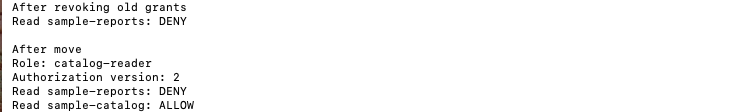
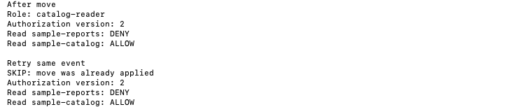

# Sprint 04 · Mover

This local exercise changes `summary-agent` from a report reader to a catalog reader. It uses a synthetic starting record and a trusted move request. Run from the repository folder:

```sh
python3 sprint-04-mover/mover.py
```

## 01. Check access before the move


The starting agent can read `sample-reports`. The catalog read is denied.

## 02. Revoke and replace access



The script clears the report grant first, then installs the catalog grant and increments the authorization version to 2. The report stays denied and the catalog becomes readable.

## 03. Reject a stale move


Changing `expected_authorization_version` to 0 in `move-request.json` causes a denial against the version 1 starting record. Restore the expected version to 1 to run the valid move again.

## 04. Skip a duplicate event



The script submits the same event again within the run. It skips the retry, keeps version 2, and preserves both access decisions.

## Screenshot index

| Figure | Evidence |
| --- | --- |
| 01 | [Starting access](screenshots/01-before-move.png) |
| 02 | [Revocation and replacement](screenshots/02-apply-move.png) |
| 03 | [Stale move denial](screenshots/03-stale-move.png) |
| 04 | [Duplicate event skipped](screenshots/04-retry-move.png) |

The screenshots are actual Terminal output cropped to remove personal paths and prompts. The exercise ran locally at $0. Agent changes and processed event IDs live in memory for one run. Durable storage, concurrent requests, and independent validation of replacement grants are outside this exercise.
