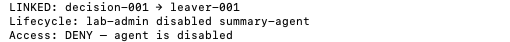
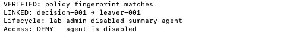

# Sprint 06 · Audit

This local exercise links a synthetic catalog access denial to an offboarding event and compares the recorded SHA-256 fingerprint with the current Sprint 5 script. Run `python3 sprint-06-audit/audit.py` from the repository folder.

## 01. Link the decision to offboarding

The sample decision points to the offboarding event for the same agent. This capture predates the fingerprint check.

## 02. Flag a missing lifecycle event

Setting the decision’s event reference to `leaver-999` triggered review because the event was absent.

## 03. Flag an agent mismatch

Keeping the event reference valid and changing the decision’s agent to `other-agent` triggered review.

## 04. Verify the recorded fingerprint

With the original records restored, the recorded SHA-256 matches the current Sprint 5 script and the records link.

## 05. Flag a fingerprint mismatch

Changing one character of the recorded fingerprint triggered review. The saved fixture contains the matching fingerprint.

## Screenshot index

| Figure | Evidence |
| --- | --- |
| 01 | [Link the decision to offboarding](screenshots/01-linked.png) |
| 02 | [Flag a missing lifecycle event](screenshots/02-missing-event.png) |
| 03 | [Flag an agent mismatch](screenshots/03-agent-mismatch.png) |
| 04 | [Verify the recorded fingerprint](screenshots/04-fingerprint-match.png) |
| 05 | [Flag a fingerprint mismatch](screenshots/05-fingerprint-mismatch.png) |

The screenshots show actual Terminal results cropped to remove personal paths and prompts. The JSON records are sample fixtures. The fingerprint comparison establishes a content match. The exercise has no authenticated event source or tamper-resistant log and ran locally at $0.
