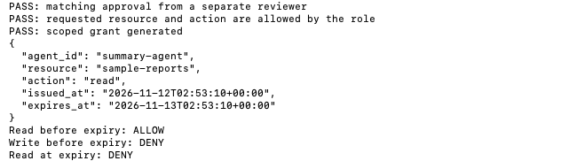
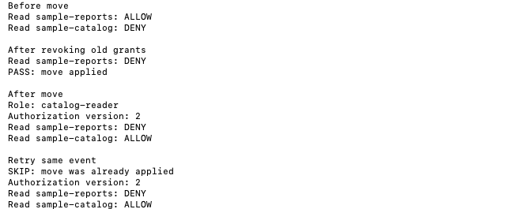
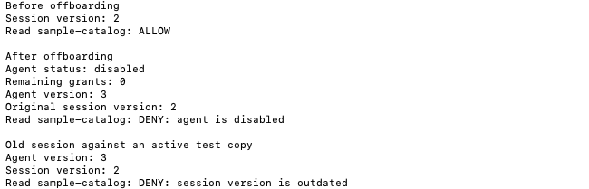
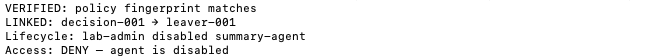

# Sprint 07 · Review and handoff

Open Terminal in the repository folder and run the commands below in order. The exercises use Python 3 and its standard library, run locally with synthetic data, and cost $0.

## 01. Reproduce the Joiner result

```sh
python3 sprint-03-joiner/joiner.py
```



The 24-hour grant allows the matching read before expiry, denies writes, and denies reads at expiry. The UTC timestamps vary by run.

## 02. Reproduce the Mover result

```sh
python3 sprint-04-mover/mover.py
```



Report access is removed before catalog access is granted. Retrying the same event leaves authorization version 2 and both access decisions unchanged.

## 03. Reproduce the Leaver result

```sh
python3 sprint-05-leaver/leaver.py
```



The original session can read the catalog before offboarding. It is denied after the agent is disabled and rejected as outdated against an active version 3 test copy.

## 04. Reproduce the Audit result

```sh
python3 sprint-06-audit/audit.py
```



The sample denial links to the offboarding event, and the recorded fingerprint matches the current Leaver script.

## Screenshot index

| Figure | Evidence |
| --- | --- |
| 01 | [Joiner rerun](screenshots/01-joiner.png) |
| 02 | [Mover rerun](screenshots/02-mover.png) |
| 03 | [Leaver rerun](screenshots/03-leaver.png) |
| 04 | [Audit rerun](screenshots/04-audit.png) |

The screenshots show the actual reruns. The personal Terminal prompts and command lines were cropped out. Each command is listed directly above its capture.

## Remaining risks

- Each script loads its own fixture. The walkthrough covers the lifecycle across separate simulations. Persistent identity state, event retries across runs, and concurrent updates remain open.
- The lab uses sample approvals and simulated sessions. A live deployment would need authenticated reviewers and a resource that enforces permissions and token revocation.
- The audit records are sample fixtures. A matching hash verifies the current file contents against the recorded value. It cannot establish who generated the record or prevent tampering with it.
